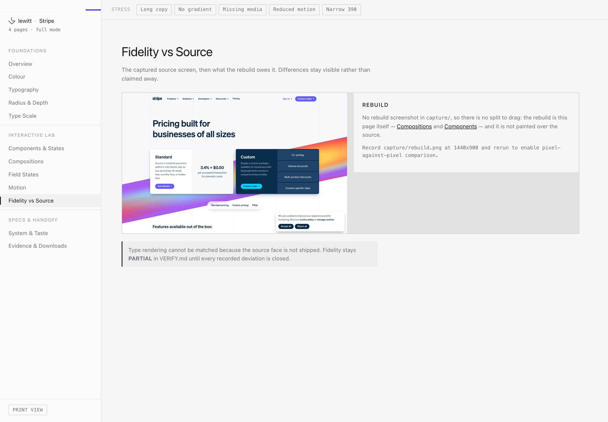
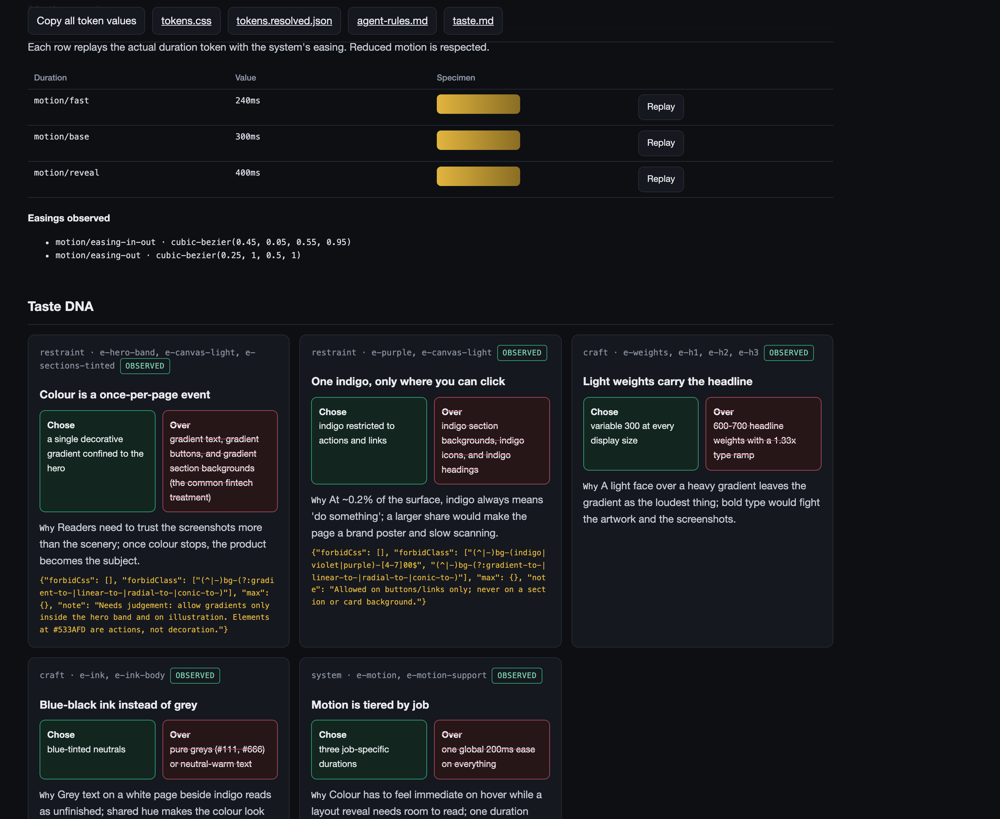

# lewitt

> *"The idea becomes a machine that makes the art."* — Sol LeWitt

**`lewitt`** is an agent skill that reverse-engineers any website URL into an evidence-backed **Design DNA**, a zero-dependency **interactive preview**, and **machine-enforceable coding guardrails** for AI agents.

Giving an AI raw hex codes and font sizes produces generic slop. Taste is not a spec sheet — it is **trade-offs and restraint**. Named after conceptual artist Sol LeWitt, whose wall drawings were executed from precise written instruction sets, `lewitt` extracts *why* a site looks the way it does, encodes what it **refuses to do**, and enforces those constraints when you build.


---

## Core Principles

- **Evidence over guesswork (R1)**: captures rendered DOM, computed styles and screenshots in an isolated browser context (Playwright, evaluated over CDP). Every finding is tagged `Observed`, `Inferred`, `Proposed` or `Unknown`; a screenshot estimate is never disguised as a measured CSS value.
- **Taste as trade-offs, plus code guardrails (R2)**: raw measurements are distilled into structural patterns and *Chose A over B* principles. Every **Restraint** principle carries a machine-readable guardrail (forbidden CSS properties, Tailwind v3/v4 class patterns, value caps) that a linter checks — not a wish.
- **Single source of truth (R3)**: `dna.json` is the only authored file. `taste.md`, `tokens.css`, `tokens.resolved.json`, `agent-rules.md` and `preview.html` are deterministic renders of it (~33 ms) and are byte-compared against drift.
- **Honest verification**: visual fidelity is tracked in `fidelity.json` (`unverified` / `PARTIAL` / `PASS`) with explicit recorded deviations — never silently claimed as a 1:1 match.

## Two Speeds

### 1. DNA mode (default, 1–2 min)

Inspects the entry page plus up to 3 representative subpages, then deterministically renders:

- **`preview.html`** — single file, zero remote assets, linked to the same `tokens.css`: live swatches (Semantic → Component → Primitive) with evidence ids, type/radius/shadow specimens, clickable **Motion Replay** driven by the real duration tokens (respects `prefers-reduced-motion`), *Chose vs Over* Taste DNA cards, source screenshots, and a one-click handoff bar.
- **`agent-rules.md`** — condensed instruction set with **MUST NOT** guardrails pinned at the top; tokens ordered Semantic → Component → Primitive.
- **`taste.md`**, **`tokens.css`**, **`tokens.resolved.json`**, **`VERIFY.md`**.

### 2. Full mode (`--full`)

Everything above, plus a runnable **`system/`** reference site built on the source's own extracted canvas colour (never forcing a generic dark docs theme onto a light system):



- component anatomy and state matrices (`default / hover / focus-visible / active / disabled`, forced samples labelled, live controls beside them)
- real compositions assembled strictly from extracted tokens (hero, pricing cards, checkout flow)
- five live stress toggles (long copy, missing media, no-gradient fallback, reduced motion, 390 px viewport)
- side-by-side **Fidelity vs source**, backed by `fidelity.json`



## Output Structure

Every run writes to an isolated `{dest}/{domain}/` directory:

```text
{dest}/{domain}/
├── dna.json               # single source of truth (evidence, measurements, patterns, taste, tokens)
├── preview.html           # zero-dependency interactive preview (every mode)
├── shadcn-theme.css       # shadcn/ui + Tailwind v4 @theme slots (unmapped slots declared)
├── cert.md / cert.json    # `lewitt cert` verdict for a running build
├── taste.md               # human-readable anatomy, token table and Taste DNA
├── agent-rules.md         # condensed rules for coding agents (MUST NOT guardrails on top)
├── tokens.css             # scoped CSS custom properties (--lw-*)
├── tokens.resolved.json   # resolved three-tier token registry
├── VERIFY.md              # mechanical audit report
├── verify.json            # machine gate results + the exact rendered snapshot
├── fidelity.json          # match/deviation log for visual fidelity (--full)
├── capture/               # raw DOM snapshots and viewport screenshots for traceability
└── system/                # (--full only) runnable design-system site
```

Sample runs included in this repository:

- [`runs/stripe.com/`](runs/stripe.com) — full mode (`preview.html` + `system/index.html` + `fidelity.json`)
- [`runs/linear.app/`](runs/linear.app) — DNA mode (restraint: white as the only action colour)
- [`runs/binance.com/`](runs/binance.com) — DNA + full (accent share tracks product density)

## Installation

```sh
# 1. Clone and link to your agent
git clone https://github.com/CClishan/lewitt-skill.git ~/Projects/skills/lewitt
ln -s ~/Projects/skills/lewitt ~/.codex/skills/lewitt
ln -s ~/Projects/skills/lewitt ~/.claude/skills/lewitt

# 2. Initialize the browser capture driver
cd ~/Projects/skills/lewitt
bash scripts/setup.sh
```

`capture.py` finds Playwright through `LEWITT_PW_DIR` → the skill's own `node_modules` → global/npx,
and runs in an isolated browser context by default. Rendering and linting need only Python 3.10+.

## Usage

```text
Use lewitt to analyze https://stripe.com              # DNA mode + preview.html
Use lewitt to analyze https://stripe.com --full        # also build the system/ reference site
Update the tokens and pricing evidence for stripe.com # incremental: only these blocks rerun
```

## Bring It Into a shadcn/ui + Tailwind v4 Project

```sh
python3 scripts/build_artifacts.py --dest runs/stripe.com --export=shadcn   # write shadcn-theme.css
python3 scripts/build_artifacts.py --dest runs/stripe.com --print-theme     # paste into globals.css
```

`shadcn-theme.css` maps `--background`, `--foreground`, `--card`, `--primary`, `--muted`,
`--border`, `--ring`, `--radius` … from the extracted **semantic** tokens and wraps them in
Tailwind v4's `@theme inline`. A slot the site does not define is written as `initial` and listed
in the file header — nothing is invented. The dark/light scheme line is derived from the canvas
token's luminance.

## Data Contract (`dna.json` schema 1.1)

`dna.json` is a protocol, not a workflow: `schemaVersion`, `meta`, `evidence`, `measurements`,
`patterns`, `taste`, `tokens`, and (1.1) `interactions`. The contract lives in
[`dna.schema.json`](dna.schema.json); `build_artifacts.py::validate` is the executable authority,
and any companion tool that reads or writes this file stays compatible.

Interaction deltas are measured, not guessed: the capture driver hovers representatives with a
real CDP mouse and calls `element.focus()`, recording before→after values for
`background-color, color, border-color, box-shadow, outline, transform`.

## Certify What You Built (`lewitt cert`)

```sh
python3 scripts/cert.py --url http://localhost:3000 --dest runs/stripe.com
```

Like the certificate LeWitt signed once an assistant had executed the wall drawing, `cert` audits a
running page against the extraction: token values read from **your page's own** CSS custom
properties, component type sizes and radii applied to a probe element, plus a scan of every element's
classes and `box-shadow` for guardrail hits. It writes `cert.md` / `cert.html` / `cert.json` with a
verdict — `certified`, `warned`, `rejected`, `inconclusive` — and exits non-zero on anything but a
clean pass. Anything it could not measure is listed, never assumed.

## Clip One Block (`lewitt clip`)

```sh
python3 scripts/clip.py --url https://example.com --find "See how it works" --dest ./bricks
```

No extraction needed. It finds the module by text or selector, records hover/click with real CDP
input, then records the same interaction again under `prefers-reduced-motion: reduce`, strips the
source skin and maps it to **shadcn / Tailwind v4 slots by role** (`--card`, `--muted`, `--primary`,
`--radius`). Output: `brick.json`, `brick.md` (states, deltas, slot mapping, state machine with
`observed: true/false`, a measured Reduced motion chapter) and keyframe screenshots.

## Enforce Guardrails on Your Own Code

Feed `agent-rules.md` and `tokens.css` to your coding agent, then lint the UI you built against the extracted Restraint guardrails before shipping:

```sh
python3 scripts/lint_output.py --dest runs/stripe.com --check-code ./src
```

Example: Linear's *"depth is a hairline, not a shadow"* principle rejects `shadow-lg` and any
`box-shadow` with offset or blur, while stripe's *"colour is a once-per-page event"* rejects
`bg-gradient-to-*` and Tailwind v4's `bg-linear-to-*`.

## Architecture

```text
Phase 0  Brief   → scope, mode (DNA vs --full), incremental freeze detection
Phase 1  Sense   → isolated Playwright/CDP capture + structured evidence ledger
Phase 2  Infer   → Measure → Pattern → Taste DNA (trade-offs + restraint guardrails)
Phase 3  Model   → three-tier token registry (primitive / semantic / component) + status tags
Phase 4  Build   → deterministic render from dna.json (+ optional --full system/ site)
Phase 5  Verify  → anti-slop grep, R3 byte-equality, colour scope, guardrail code check, fidelity
```

## Credits

The Measure → Pattern → Taste reasoning chain and the banned-word discipline come from
[`taste-skill`](https://github.com/senlindesign/taste-skill) (MIT, Senlin). The evidence ledger,
token layering and verification table come from
[`website-design-system`](https://github.com/DiqingWWW/Web-Design-System-Skill) (DiqingWWW).
`lewitt` is the merge.

## License

MIT
