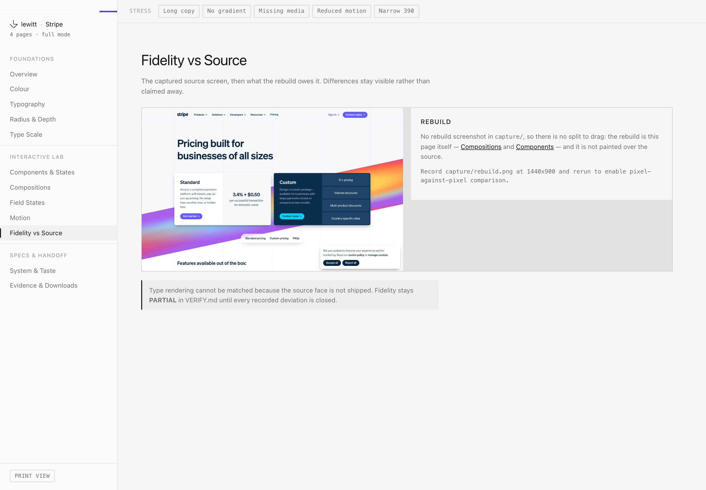

# lewitt

[在线页面](https://koroo.top/lewitt) · [工作原理](https://koroo.top/lewitt/about) · [下载 SKILL.md](https://koroo.top/lewitt/SKILL.md)

> *"The idea becomes a machine that makes the art."* — Sol LeWitt

**`lewitt`** 是一个 agent skill：给一个网址，产出一份靠测量得到的 token、一套可直接粘贴的 shadcn / Tailwind v4 主题、一份 agent 规则，以及 linter 能机械检查的 guardrail。

只给 AI hex 和字号，它就会产出模板化的东西。品味不是规格表，而是**取舍与克制**。名字取自观念艺术家 Sol LeWitt —— 他的墙面绘画由一份精确的书面指令执行；`lewitt` 提取的是"为什么长这样"，并把网站**拒绝做什么**编码成约束，在你动手写界面时强制检查。


## 三块拼图

- **R1 证据不降级**：在隔离的浏览器上下文里抓渲染后的 DOM、计算样式与截图（Playwright，经 CDP 求值）。每条结论都标 `Observed` / `Inferred` / `Proposed` / `Unknown`，截图估测绝不冒充实测 CSS。
- **R2 品味 = 取舍 + 代码 guardrail**：测量先压成结构模式，再提炼成「选 A 弃 B」。每条 **Restraint** 原则都带机器可读的 guardrail（禁用 CSS 属性、Tailwind v3/v4 类名模式、数值上限），由 linter 检查，而不是写在文档里自说自话。
- **R3 单一真源**：`dna.json` 是唯一手写的文件。`taste.md`、`tokens.css`、`tokens.resolved.json`、`agent-rules.md`、`preview.html` 都由它确定性渲染（约 33ms），并做逐字节漂移比对。
- **诚实的验收**：视觉保真度记录在 `fidelity.json`（`unverified` / `PARTIAL` / `PASS`），偏差逐条写明，绝不悄悄宣称 1:1 还原。

| 组件 | 命令 | 做什么 | 产出 |
| :--- | :--- | :--- | :--- |
| **提取** | `lewitt <url>`（加 `--full` 出参考站） | 读 1–4 个页面，记录计算样式、截图、交互差值，提炼取舍 | `dna.json`、`taste.md`、`agent-rules.md`、`tokens.css`、`shadcn-theme.css`、`preview.html`、`VERIFY.md` |
| **切片** | `scripts/clip.py` | 从任意页面切一个局部模块或微交互，剥掉源站皮肤，录 reduce 分支 | `brick.md`、`brick.json`、`shots/` |
| **验收** | `scripts/cert.py` | 用提取结果审计本地跑着的构建 | `cert.md`、`cert.html`、`cert.json` |

三块可单独用：切片不需要先提取，验收需要（`dna.json` 就是它对照的规格）。

## 三种模式

**1. DNA 模式（默认，1–2 分钟）**：抓 1 个首页 + 最多 3 个代表性子页，输出 `preview.html`（单文件、无远程资源、与 `tokens.css` 同源：实时色板、字阶/圆角/阴影样例、可点击的动效回放、Taste DNA 卡片、源站截图、一键下载栏）、`agent-rules.md`（MUST NOT 硬约束置顶，token 按 Semantic → Component → Primitive 排列）、`taste.md`、`tokens.css`、`tokens.resolved.json`、`VERIFY.md`。

**2. 完整模式（`--full`）**：额外生成可运行的 `system/` 参考站，页面底色取自源站自己的 canvas token（不会把深色文档主题硬套到浅色系统上）：组件解剖与状态矩阵、用同一套 token 拼出的真实组合（Hero / Pricing / Checkout）、5 个压力测试开关、与源站并排的保真度对照。



### 3. 切片（`scripts/clip.py`）

```sh
python3 scripts/clip.py --url https://www.onepixelai.com/ --find "Index" --dest ./bricks --action hover
```

不需要 `dna.json`，输出在 `./bricks/clips/{domain}-{slug}/`。`brick.md` 里有：

- **按角色剥皮**：源站颜色按对比度与角色映射到 `--card` / `--secondary` / `--primary` / `--radius`，不做最近色匹配；文件开头写明抄源站 hex 是违规。
- **四个采样目标**：触发元素、局部容器、鼠标下实际元素、点击后打开的面板，按 `before → during → settled → idle` 对比。
- **实测 reduce 分支**：同一段时间线在 `prefers-reduced-motion: reduce` 下重放，判为 `degraded` / `degraded-to-none` / `not-degraded`，两个时长都写出来。

### 4. 验收（`scripts/cert.py`）

```sh
python3 scripts/cert.py --url http://localhost:3000 --dest runs/stripe.com
```

取值按三级优先，`cert.md` 里逐行写明是哪一级给的：

1. `tokens.css` 里的 `--lw-*`；
2. shadcn / Tailwind v4 槽位（`--background`、`--primary`、`--muted-foreground`、`--border`、`--radius`）；
3. 页面自己的计算样式（`body`、`h1`、第一个按钮、第一个卡片）。

有意改动写进 `{run_dir}/cert.config.json` 并给出理由；判定为 `certified` / `warned` / `rejected` / `inconclusive`，除直接通过外退出码非 0。

## 产物结构

```text
{dest}/{domain}/
├── dna.json               # 唯一真源（evidence / measurements / patterns / taste / tokens / interactions）
├── shadcn-theme.css       # shadcn / Tailwind v4 @theme inline（未映射槽位写成 initial 并列出）
├── cert.md / cert.json    # 验收结果
├── clips/                 # 切片产物（brick.json / brick.md / shots/）
├── preview.html           # 零依赖交互预览
├── taste.md / agent-rules.md / tokens.css / tokens.resolved.json
├── VERIFY.md / verify.json
├── fidelity.json          # --full：一致项与偏差项
├── capture/               # 原始 DOM 快照与视口截图
└── system/                # --full：可运行的参考站
```

仓库内附带三个样例：`runs/stripe.com/`（完整模式，另含切片集与验收单）、`runs/linear.app/`（DNA 模式）、`runs/binance.com/`（完整模式）。

## 安装

```sh
git clone https://github.com/CClishan/lewitt-skill.git ~/Projects/skills/lewitt
ln -s ~/Projects/skills/lewitt ~/.codex/skills/lewitt
ln -s ~/Projects/skills/lewitt ~/.claude/skills/lewitt
ln -s ~/Projects/skills/lewitt ~/.dsh/skills/lewitt
cd ~/Projects/skills/lewitt && bash scripts/setup.sh
```

## 接进 shadcn/ui + Tailwind v4 项目

```sh
python3 scripts/build_artifacts.py --dest runs/stripe.com --export=shadcn   # 生成 shadcn-theme.css
python3 scripts/build_artifacts.py --dest runs/stripe.com --print-theme     # 直接粘贴进 globals.css
```

`--background / --foreground / --card / --primary / --muted / --border / --ring / --radius` 等槽位
从提取出的 **semantic** token 映射，外面套 Tailwind v4 的 `@theme inline`。源站没有对应 token 的
槽位写成 `initial` 并在文件头列出——不编造。明暗色由 canvas token 的亮度自动判定。

`dna.json` 是数据协议（schema 1.1），契约见 [`dna.schema.json`](dna.schema.json)，`validate()` 是可执行权威。

## 用 guardrail 检查你自己的代码

```sh
python3 scripts/lint_output.py --dest runs/stripe.com --check-code ./src
python3 scripts/lint_output.py --dest ./bricks      # 只有切片的目录也能单独过门禁
```

例：Linear 的「层次靠 1px 细线，不靠阴影」会拦下 `shadow-lg` 和任何带位移/模糊的 `box-shadow`；Stripe 的「颜色一页只用一次」会拦下 `bg-gradient-to-*` 和 Tailwind v4 的 `bg-linear-to-*`。

## 致谢

推理链（Measure → Pattern → Taste）与反 slop 词表来自 [`taste-skill`](https://github.com/senlindesign/taste-skill)（MIT，Senlin）；证据台账、token 分层与验收表来自 [`website-design-system`](https://github.com/DiqingWWW/Web-Design-System-Skill)（DiqingWWW）。`lewitt` 是两者的合体。

## License

MIT
